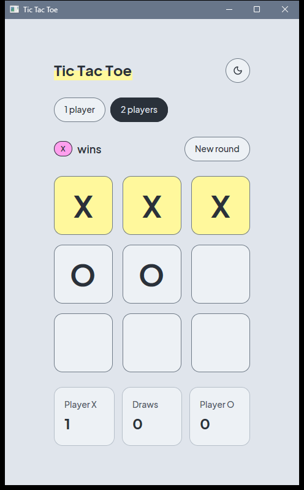
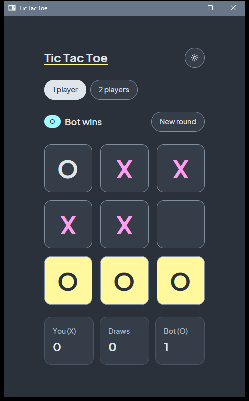

# GPUI Tic Tac Toe

A desktop Tic Tac Toe game written in Rust with GPUI (through the `gpui-kit` 0.9.0 crate), styled with the vjump.dev "Highlighter Notebook" design system.

<p align="center">
  
  
</p>

Left: light theme, 2 players, X wins the top row. Right: dark theme, 1 player, the bot wins the bottom row.

## Features

- **1 player.** You play X against a minimax bot that plays O. The bot is perfect and deterministic, so the best a human can get is a draw. X always moves first, and the bot replies instantly.
- **2 players.** Two people take turns on the same screen (local hot-seat). X moves first.
- **Session score.** Each mode keeps its own tally of X wins, O wins and draws. Switching mode resets the board and the score. "New round" clears the board and keeps the score. The score is not saved between launches.
- **Light and dark themes.** The theme follows the system appearance at launch, and a button in the header toggles it. The choice is not persisted.
- **Keyboard support.** Every action is reachable without a mouse (see below).

## Controls

| Input | Action |
| --- | --- |
| Click a cell | Place your mark |
| Tab | Move focus into the board. The board is a single Tab stop that remembers the last cell you used. |
| Arrow keys | Move between cells while the board has focus. Movement stops at the edges. |
| Enter or Space | Play the focused cell |
| Ctrl+N (Cmd+N on macOS) | Start a new round |

The arrow keys work once a cell has focus, so press Tab to enter the board first. Clicking a cell plays it but does not move keyboard focus.

## Requirements

- Rust stable with edition 2024 support. The code uses let chains, so Rust 1.88 or newer is required. It was developed on 1.99.1.
- On Windows:
  - The MSVC toolchain: Visual Studio Build Tools with the "Desktop development with C++" workload.
  - The Windows 10 or 11 SDK. GPUI uses `rc.exe` from the SDK to embed the application manifest, and release builds also use the SDK's `fxc.exe` to compile shaders. If `fxc.exe` is not on `PATH` or in an installed SDK, set `GPUI_FXC_PATH` to its location.

This project was built and tested on Windows 11 only. Other platforms that GPUI supports are untested.

The first build compiles GPUI and its dependencies and takes several minutes. Debug, test and release builds are compiled separately.

## Commands

```sh
# Run a debug build
cargo run

# Run an optimized build. The release executable has no console window:
# target\release\gpui-tic-tac-toe.exe
cargo run --release

# Run the tests (23 tests, see below)
cargo test

# Lint and format checks
cargo clippy --all-targets -- -D warnings
cargo fmt --check
```

`cargo test` runs 23 tests:

- Pure unit tests for the rules (`game.rs`), the bot (`bot.rs`) and the session (`session.rs`). One of them plays every possible sequence of human moves against the bot and checks that the bot never loses and that each round is scored exactly once.
- Four UI integration tests (`ui_tests.rs`), written with `#[gpui_kit::test]`. They open the real view in a headless window and use native clicks and key presses: clicking a cell, arrow-key focus plus Enter, switching mode, and the new-round shortcut.

## Project structure

```text
.
├── Cargo.toml              Package gpui-tic-tac-toe; depends on gpui-kit 0.9.0
├── assets/
│   └── fonts/              Plus Jakarta Sans (Regular, Medium, SemiBold, Bold) and its OFL license
├── docs/
│   └── screenshots/        light.png and dark.png, used by this README
├── src/
│   ├── main.rs             Starts the app, opens the window, quits when it closes
│   ├── app.rs              The TicTacToeApp view, actions, key bindings and focus handling
│   ├── game.rs             Marks, the 3x3 board and win/draw detection (no GPUI)
│   ├── bot.rs              Minimax bot: best_move for a board (no GPUI)
│   ├── session.rs          Mode, turn, score and the play/new-round/set-mode rules (no GPUI)
│   ├── theme.rs            Registers the font and themes; resolves brand colors from the active theme
│   └── ui_tests.rs         UI integration tests (compiled only for tests)
└── themes/
    └── vjump.json          Light and dark gpui-kit themes, the only place raw colors appear
```

`game.rs`, `bot.rs` and `session.rs` have no GPUI imports, so the rules and the bot are tested with plain `#[test]` functions.

## Design system notes

The visual design follows the vjump.dev `DESIGN.md` ("The Highlighter Notebook": cool grey paper, graphite ink and three highlighter pens).

**Colors.** All raw colors live in `themes/vjump.json`. It defines "Vjump Light" and "Vjump Dark" and `theme::install` registers both as gpui-kit themes, so a theme switch keeps the notebook palette. No file under `src/` contains a color literal. `theme::brand()` reads these roles from the active theme:

| Brand role | gpui-kit theme color | Theme file key |
| --- | --- | --- |
| Card | `group_box` | `group_box.background` |
| Ink | `primary_foreground` | `primary.foreground` |
| Pink ink | `ring` | `ring` |
| Highlighter yellow | `primary` | `primary.background` (also `base.yellow`) |
| Highlighter cyan | `cyan` | `base.cyan` |
| Highlighter pink | `magenta` | `base.magenta` |

**How the brand elements are used.**

- X is drawn with a pink-ink glyph and tagged with a pink highlighter pill. O is drawn in the foreground color and tagged with a cyan pill. Tags carry ink text and a 1px ink border in the light theme; the border is transparent in the dark theme.
- A finished round highlights the winning line: those cells fill with yellow and their glyphs switch to ink.
- The active mode chip inverts ink and paper (foreground fill, background text).
- The title marker is a yellow swipe behind the text in the light theme and a thick yellow underline in the dark theme, where a pale swipe would wash out the light text.
- Chips, tags, the New round button and the theme toggle are pills. The chips, the New round button and the theme toggle are 40px tall.
- Surfaces are flat: cards and tiles are separated by tone and a 1px border, with no shadows.

**Known deviations from the design system.**

- The theme toggle's hover uses the muted wash instead of a pink border.
- Icons are 16px (the gpui-kit default) instead of 18px.
- There is no letter-spacing, because GPUI does not support it.
- The title marker is not animated.
- Kanit and Geist Mono are not bundled, because the UI has no Thai text or code.

## License and credits

- Plus Jakarta Sans is by Tokotype and is licensed under the SIL Open Font License 1.1. The license text is in `assets/fonts/OFL.txt`.
- No license file is included for the project code yet.
